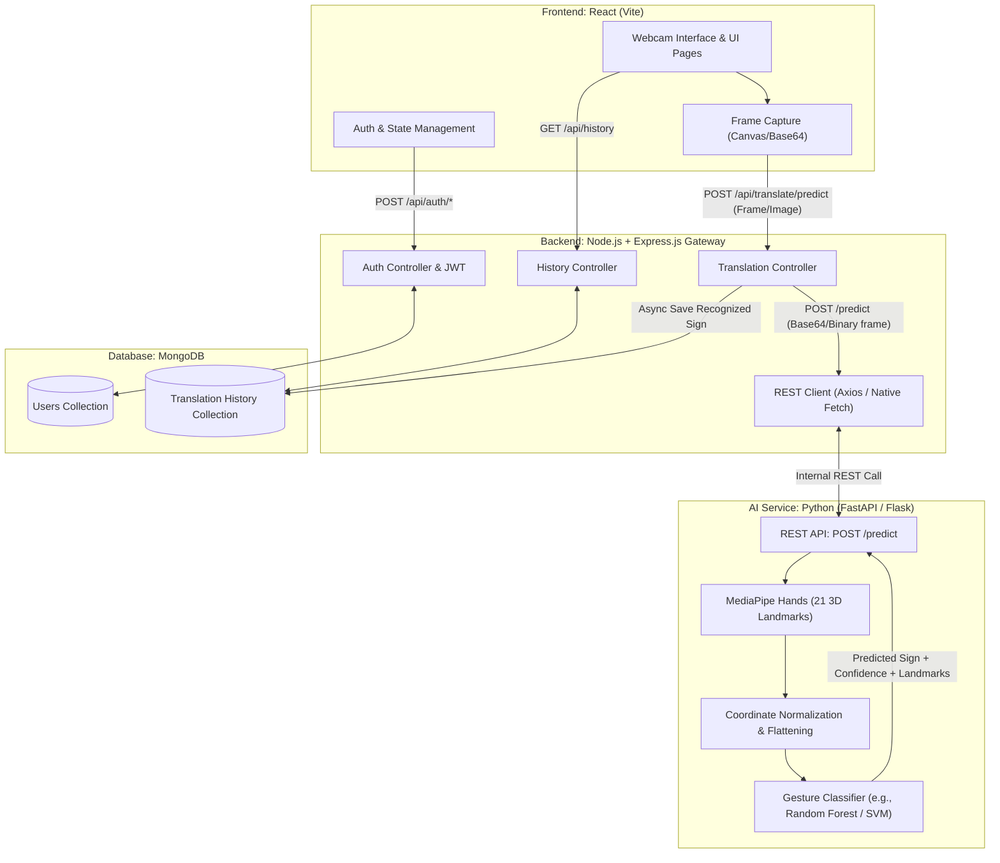

# Architecture & Project Structure: Indian Sign Language (ISL) Translator Web Portal

## Overview
The **Indian Sign Language (ISL) Translator Web Portal** is a full-stack educational and accessibility web platform designed to capture sign gestures via webcam, process hand landmarks with MediaPipe and computer vision, classify signs using machine learning, and deliver real-time textual translation with user authentication and history tracking.

This document outlines the system architecture, component breakdown, communication protocol, and proposed repository layout without unnecessary third-party bloat.

---

## High-Level System Architecture



---

## Component Breakdown & Technology Choices

### 1. Frontend (`client/`)
- **Core**: React (using Vite for ultra-fast builds and zero bloat).
- **Styling**: Modern Vanilla CSS / CSS Modules (clean dark mode, accessible typography, zero heavy CSS framework overhead).
- **Functionality**:
  - Webcam video feed capture using standard Web APIs (`navigator.mediaDevices.getUserMedia` & HTML `<canvas>`).
  - Auth context for login/registration session management (JWT storage).
  - Live translation dashboard with dynamic output display (letter/word building, confidence score).
  - History viewer with timestamps and export/clear features.

### 2. Backend Gateway (`server/`)
- **Core**: Node.js with Express.js.
- **Database Connection**: Mongoose connecting to MongoDB.
- **Role**:
  - **API Gateway & Orchestrator**: Acts as the single entry point for the React client.
  - **Authentication**: Secure password hashing (`bcryptjs`) and session tokens (`jsonwebtoken`).
  - **Translation Dispatcher**: Receives captured frame payloads from the client and forwards them to the Python AI service over HTTP REST.
  - **Persistence**: Automatically logs recognized signs and timestamps to MongoDB when authenticated users translate signs.

### 3. AI & Computer Vision Microservice (`ai-service/`)
- **Core**: Python 3.10+ with **FastAPI** (recommended over Flask for native async high throughput, automatic request validation, and OpenAPI documentation).
- **Computer Vision**: OpenCV (`opencv-python-headless`) for image decoding/manipulation.
- **Landmark Extraction**: **MediaPipe Hands** extracting 21 3D hand landmarks (x, y, z) per detected hand.
- **Classifier**: Machine Learning classifier (Scikit-Learn `RandomForestClassifier` or `SVM` or lightweight MLP) trained on normalized landmark coordinates rather than raw pixels (ensures lightning-fast inference < 30ms and high accuracy invariant to skin color or room background).
- **Training Subsystem**: Clean standalone scripts to record landmark datasets using webcam and train the classifier.

### 4. Database Layer (`MongoDB`)
- **`users`**: `_id`, `name`, `email`, `passwordHash`, `createdAt`.
- **`translation_histories`**: `_id`, `userId` (ref), `recognizedText`, `confidence`, `timestamp`.

---

## Proposed Folder Structure

```text
ISL_Translator/
│
├── client/                          # Frontend Application (React + Vite)
│   ├── public/                      # Static assets (favicons, icons)
│   ├── src/
│   │   ├── assets/                  # Images, branding assets
│   │   ├── components/              # Modular UI components
│   │   │   ├── Navbar.jsx           # Top navigation and user profile summary
│   │   │   ├── WebcamCapture.jsx    # Camera feed capture, frame rate throttler, canvas hook
│   │   │   ├── TranslationCard.jsx  # Displays current sign, confidence score, text builder
│   │   │   ├── HistoryList.jsx      # Historical translations list with timestamps
│   │   │   └── ProtectedRoute.jsx   # Route guard for authenticated views
│   │   ├── context/
│   │   │   └── AuthContext.jsx      # Global user auth state
│   │   ├── pages/
│   │   │   ├── Home.jsx             # Project introduction, demo sign chart
│   │   │   ├── Translator.jsx       # Main real-time translation workspace
│   │   │   ├── History.jsx          # User translation history page
│   │   │   ├── Login.jsx            # Sign in
│   │   │   └── Register.jsx         # Sign up
│   │   ├── services/
│   │   │   └── api.js               # Centralized Axios/fetch wrapper with JWT interceptor
│   │   ├── styles/
│   │   │   ├── index.css            # Global CSS variables, reset, typography
│   │   │   └── components.css       # Clean reusable component styles
│   │   ├── App.jsx                  # Route definitions
│   │   └── main.jsx                 # React root mounting
│   ├── index.html
│   ├── package.json
│   └── vite.config.js
│
├── server/                          # Node.js + Express Backend
│   ├── src/
│   │   ├── config/
│   │   │   └── db.js                # MongoDB connection handler
│   │   ├── controllers/
│   │   │   ├── authController.js    # Login, registration, token verification
│   │   │   ├── translateController.js # Forwards frame to Python AI service, logs result
│   │   │   └── historyController.js # Query, clear, or fetch translation history
│   │   ├── middleware/
│   │   │   ├── authMiddleware.js    # JWT verification middleware
│   │   │   └── errorHandler.js      # Centralized error handler
│   │   ├── models/
│   │   │   ├── User.js              # User Mongoose schema
│   │   │   └── History.js           # Translation history Mongoose schema
│   │   ├── routes/
│   │   │   ├── authRoutes.js        # /api/auth endpoints
│   │   │   ├── translateRoutes.js   # /api/translate endpoints
│   │   │   └── historyRoutes.js     # /api/history endpoints
│   │   ├── services/
│   │   │   └── aiService.js         # REST client communicating with Python microservice
│   │   └── server.js                # Express app initialization & server startup
│   ├── .env.example                 # PORT, MONGO_URI, JWT_SECRET, AI_SERVICE_URL
│   └── package.json
│
├── ai-service/                      # Python MediaPipe & ML Service
│   ├── app/
│   │   ├── api/
│   │   │   └── routes.py            # POST /predict, GET /health, GET /labels
│   │   ├── core/
│   │   │   └── config.py            # Environment configurations (host, port, model path)
│   │   ├── ml/
│   │   │   ├── mediapipe_engine.py  # MediaPipe Hands detector & landmark normalizer
│   │   │   ├── classifier.py        # Model loading & gesture inference
│   │   │   └── model_data/          # Serialized model (.pkl/.joblib) & labels mapping (.json)
│   │   │       ├── isl_model.pkl
│   │   │       └── labels.json
│   │   ├── schemas/
│   │   │   └── predict_schema.py    # Pydantic schemas for Request (base64 image) & Response
│   │   └── main.py                  # FastAPI app entry point
│   │
│   ├── training/                    # Standalone Offline ML Workflow (Not run in production)
│   │   ├── collect_samples.py       # OpenCV script to capture landmark training data
│   │   ├── train_model.py           # Trains ML classifier (RandomForest/SVM) & evaluates metrics
│   │   └── dataset/                 # Captured coordinate CSVs / pickles
│   │
│   ├── requirements.txt             # Minimal dependencies (fastapi, uvicorn, mediapipe, opencv-python-headless, scikit-learn)
│   └── .env.example
│
└── README.md                        # Documentation on setup, running microservices, and dataset
```

---

## Communication Protocol & Data Flow

### 1. Inference Request Flow:
1. **Client**: The React webcam handler takes a snapshot frame every $N$ milliseconds (e.g., 3-5 frames/second or on user demand) from an HTML `<canvas>` element and encodes it as Base64 JPEG.
2. **Client $\to$ Node.js (`POST /api/translate/predict`)**:
   - Header: `Authorization: Bearer <jwt_token>` (optional for guest, required for history).
   - Body: `{ "image": "data:image/jpeg;base64,..." }`
3. **Node.js $\to$ Python AI (`POST http://localhost:8000/predict`)**:
   - Node.js `aiService.js` makes an internal HTTP POST request with the frame payload.
4. **Python Microservice Execution**:
   - Decodes base64 string into OpenCV BGR image array.
   - Passes image to `mp.solutions.hands`.
   - If hand detected: Extracts $(x, y, z)$ coordinates of 21 landmarks, normalizes coordinates relative to wrist/bounding box.
   - Feeds normalized array (42 or 63 features) into the trained classifier.
   - Returns:
     ```json
     {
       "success": true,
       "hand_detected": true,
       "sign": "A",
       "confidence": 0.96,
       "landmarks": [[0.52, 0.61], ...]
     }
     ```
5. **Node.js**:
   - Receives Python JSON response.
   - If user is authenticated and confidence > threshold, saves `{ userId, recognizedText: "A", confidence: 0.96 }` to MongoDB `History` collection.
   - Returns payload back to React frontend.
6. **Client**: Updates UI with letter, updates sign spelling buffer, and optionally renders landmark visual overlays.

---

## User Review Required

> [!IMPORTANT]
> **Python Framework Selection**: We propose **FastAPI** over Flask because:
> 1. FastAPI is 2-3x faster than Flask due to ASGI/Starlette under the hood.
> 2. It has native asynchronous request handling, which prevents blocking when handling multiple frame requests.
> 3. It includes automated Pydantic schema validation and automatic `/docs` (Swagger UI).
> *If you specifically require Flask for college curriculum requirements, let us know and we will adjust.*

> [!NOTE]
> **Direct vs Proxied Inference Call**:
> By forwarding through Node.js (`React -> Node.js -> Python`), Node.js can enforce JWT authentication, rate limiting, and write directly to MongoDB history without exposing the Python service to the public internet.

---

## Verification Plan

### Phase 1: Structural Verification (Immediate Next Step)
- Create repository folders (`client`, `server`, `ai-service`).
- Set up initial `.gitignore`, `package.json` files for client and server, and `requirements.txt` for Python AI service.

### Phase 2: Microservice Communication Verification
- Test internal REST call between Node.js and Python AI service with dummy ping/predict endpoint.
- Verify MongoDB connection and User schema.

### Phase 3: MediaPipe & End-to-End Inference Verification
- Verify MediaPipe landmark extraction pipeline on sample hand gesture images.
- Verify end-to-end flow from React webcam capture to final recognized character output.
